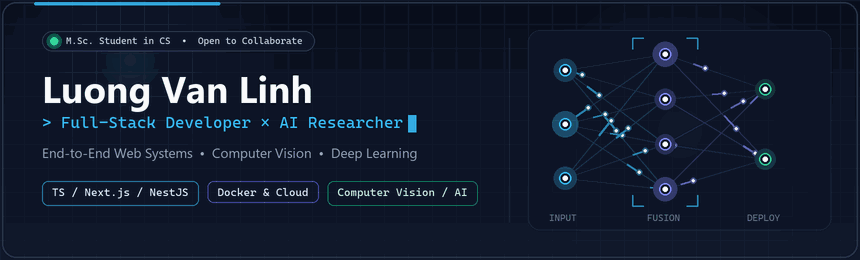

<h1 align="center">Hi 👋, I'm Luong Van Linh</h1>

  

  
  
  

  

---

### 👨‍💻 About Me

I'm a **Full-Stack Developer** and **Master's Student in Computer Science** at **Hue University** (alumnus of the Faculty of IT, **Nha Trang University**). My work bridges production web engineering with applied AI research—turning deep learning and computer vision models into practical, scalable systems.

- 🎓 **Graduate Research:** Focusing on **Computer Vision**, **Natural Language Processing**, and **Multimodal AI** (Visual Question Answering, facial behavior analysis, and real-time detection).
- 💻 **Full-Stack Engineering:** Designing end-to-end web architectures—from responsive interfaces and modular APIs to reliable data layers and containerized cloud deployments.
- 🤝 **Open To:** Full-stack engineering roles, AI-powered product development, and research collaborations.

---

### 🔬 Research & Publications

- **Classroom VQA:** A Vietnamese Visual Question Answering dataset and a **PhoBERT–EVA02** Co-Cross-Attention baseline for classroom learning-behavior monitoring.
- **Real-Time Driver Drowsiness Detection:** Temporal facial behavior analysis using facial landmark tracking and deep learning (*Journal of Science and Technology, University of Sciences, Hue University*).
- **Intelligent Campus Systems:** Event attendance tracking and student conduct evaluation web application for the Faculty of Information Technology, Nha Trang University.

Explore full papers and updates on [ResearchGate](https://www.researchgate.net/profile/Linh-Luong-Van).

---

### 🛠️ Tech Stack

| Domain | Technologies |
| :--- | :--- |
| **Languages** |   |
| **Frontend** |   |
| **Backend** |    |
| **Databases & Cache** |     |
| **DevOps & Cloud** |      |

---

### 📊 GitHub Analytics

  
  

  

---

### 📫 Get in Touch

- **Email:** [luongvanlinh.45@gmail.com](mailto:luongvanlinh.45@gmail.com)
- **LinkedIn:** [Luong Van Linh](https://www.linkedin.com/in/linh-l%C6%B0%C6%A1ng-679ba9275/)
- **ResearchGate:** [Linh Luong Van](https://www.researchgate.net/profile/Linh-Luong-Van)

  Thanks for visiting! Always open to discussing system design, full-stack engineering, and applied research.

